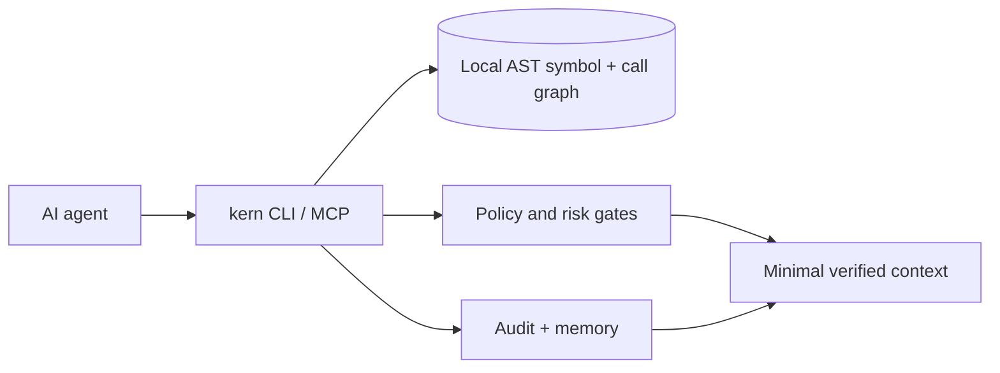

<div align="center">

# kern

### The local, deterministic code-intelligence engine for AI agents

**Index · Graph · Guard · Audit · Optimize — one self-contained CLI/MCP pair. Local-first, zero telemetry.**

[](LICENSE)
[](https://go.dev/)
[](docs/security/overview.md)
[](docs/security/overview.md)
[](docs/installation.md)
[](docs/installation.md)
[](docs/installation.md)
[](docs/installation.md)
[](docs/installation.md)
[](docs/installation.md)

**18 Indexed Languages · 74 Frameworks Recognized · Phase-aware MCP routing (11 tools advertised by default, 34 in full mode) · 100% Local**

[Quickstart](#quickstart) ·
[Why kern](#why-kern) ·
[Guides](#guides) ·
[CLI](#cli-highlights) ·
[Security](#security) ·
[Full docs](docs/index.md)

</div>

---

## Quickstart

1. Install the prebuilt binaries:

   ```bash
   # macOS / Linux
   curl -fsSL https://raw.githubusercontent.com/JayveerPrajapati/kern/main/install.sh | sh

   # Windows PowerShell
   powershell -ExecutionPolicy Bypass -c "irm https://raw.githubusercontent.com/JayveerPrajapati/kern/main/install.ps1 | iex"
   ```

2. Index your project:

   ```bash
   kern index .
   ```

3. Ask your agent:

   > What breaks if I change `Server.dispatch`?

Agent wiring is **opt-in**. The installer only downloads and verifies binaries;
pass `--wire` (PowerShell `-Wire`) or run `kern setup --global` when you want
machine-wide integration. `kern setup --dry-run` previews every write.

For Homebrew, Go, Windows, offline, upgrade, and uninstall instructions, see
[the installation guide](docs/installation.md).

---

## Why kern

Naive agent workflows read whole files and grep for strings. That burns context,
misses indirect dependencies, leaks secrets, and makes large refactors feel
risky.

kern gives agents a deterministic, AST-backed symbol graph:

| Capability | What it gives your agent |
|---|---|
| **Surgical context** | A symbol, its callers, callees, and dependent files without whole-file dumps |
| **Blast radius** | Deterministic impact and covering-test analysis before an edit |
| **Governance** | Risk-assisted execution, workspace confinement, and approval gates |
| **Auditability** | Tamper-evident local audit records and evidence anchors |
| **Privacy** | Local indexes, no telemetry, automatic secret/PII masking |
| **Cost control** | Compact context and measured token savings |

Measured results and benchmark protocols live in
[docs/benchmarks/overview.md](docs/benchmarks/overview.md).

---

## Guides

- [Installation and quickstart](docs/installation.md) — install, opt into wiring, index, verify.
- [MCP overview](docs/mcp/overview.md) — supported clients, tool routing, and full/default surfaces.
- [Security and governance](docs/security/overview.md) — defaults, approvals, sandboxing, privacy, and break-glass.
- [SDKs and specialist roles](docs/sdk/README.md) — Python/TypeScript SDKs and the seven-role squad.
- [Configuration](docs/configuration.md) — files, profiles, and environment variables.
- [CLI reference](docs/cli-reference.md) — the complete command surface.
- [Full documentation](docs/index.md) — architecture, recipes, benchmarks, ADRs, and operational guides.

---

## How it works



- **Extraction:** `go/ast` for Go; native tree-sitter grammars for 12 more languages (13 grammars total, Go included); a pure-Go fallback is available.
- **Surface:** 60+ CLI commands and 34 MCP tools, with 11 direct tools advertised by default.
- **Graph intelligence:** callers, callees, blast radius, hotspots, dead code, architecture communities, and runtime entities.
- **Verification:** security, architecture, dependency, and release gates run locally.
- **Persistence:** content-hash indexes, SQLite/FTS search, project memory, and a tamper-evident audit chain.

---

## MCP surface

By default, `kern` advertises a **direct eleven-tool surface**:
`kern_buddy`, `kern_search`, `kern_explore`, `kern_context`, `kern_probe`,
`kern_research`, `kern_impact`, `kern_graph`, `kern_review`, `kern_verify`,
and the optional `kern_meta` router.

| Default tool | Purpose |
|---|---|
| **`kern_buddy`** *(default)* | Session onboarding digest |
| **`kern_search`** *(default)* | Ranked AST symbol search |
| **`kern_explore`** *(default)* | Symbol, callers, callees, and blast radius |
| **`kern_context`** *(default)* | Minimal relevant source slice |
| **`kern_probe`** *(default)* | Task-driven multi-symbol context |
| **`kern_research`** *(default)* | Read-only multi-symbol research |
| **`kern_impact`** *(default)* | Transitive change impact |
| **`kern_graph`** *(default)* | One-hop call graph |
| **`kern_review`** *(default)* | Diff review context |
| **`kern_verify`** *(default)* | Unified verification |
| **`kern_meta`** *(default)* | Natural-language router |

*The eleven ***(default)*** tools are the direct advertised surface. `KERN_MCP_FULL=1` advertises the full 34-tool catalog directly, while `kern_meta` routes only within the advertised surface behind its governance gates. `KERN_MCP_PHASE=explore|plan|edit|verify` filters either surface, and `KERN_MCP_SINGLE_TOOL=1` collapses to `kern_meta` alone.*

`kern_meta` routes only to tools that are actually advertised under the current
operator policy. That keeps `KERN_TOOLS`, phase filters, and category filters
from being bypassed through natural-language routing.

See [docs/mcp/overview.md](docs/mcp/overview.md) and the generated
[tool catalog](docs/tool-catalog.md).

---

## CLI highlights

How do I optimize a prompt? Use `kern optimize <prompt>` to strip filler,
mask secrets, and preserve the signal-bearing context. Prompt compression
requires a configured LLM provider — without one it returns the input
unchanged with a warning — while `--kind log` is deterministic and works
fully offline.

How do I compress a log? Use `kern optimize --kind log <file|text|->` to
collapse repetitive stack frames while keeping the first/last error context.

```bash
# Exploration
kern explore <symbol>   # definition, callers, callees, blast radius
kern context <symbol>  # smallest useful source slice
kern search <query>    # ranked symbol search

# Change safety
kern impact <symbol>   # transitive impact and risk
kern review            # review current changes against the index
kern guard             # architecture boundary check

# Operations
kern doctor            # installation, index, wiring, and audit health
kern optimize <prompt>  # compact, mask, and preserve signal
kern stats              # local token-saving and performance stats
```

The complete command reference is in
[docs/cli-reference.md](docs/cli-reference.md).

Source builds require Go 1.27+. Benchmark and performance claims are labeled
`measured`, `synthetic`, or `illustrative`; see the benchmark guide.

---

## Security

kern assumes that source code, logs, and model output are sensitive. Its
defaults are:

- no telemetry or background network calls,
- no machine-wide writes without explicit wiring,
- workspace-confined reads,
- fail-closed external fetch allowlists,
- approval-gated HIGH/CRITICAL execution,
- automatic secret and PII masking,
- auditable emergency bypasses.

Read the full model in [docs/security/overview.md](docs/security/overview.md)
and [`SECURITY.md`](SECURITY.md).

---

## Supported ecosystem

Go · Python · JavaScript · TypeScript · Rust · C · C++ · C# · Java · Ruby · PHP · Shell · Dart · CSS · HTML · Markdown · JSON · YAML

13 of the 18 languages use deep tree-sitter grammars in the default build;
Go is parsed directly with `go/ast`, and the pure-Go build uses regex
heuristics for 16 languages.

Recognized Frameworks (74) include Spring Boot, Django, FastAPI, Express,
Rails, Laravel, Next.js, Vue, and 66 more.

- **Agents:** opencode, Claude Code, Cursor, Codex, Gemini CLI, VS Code, Windsurf, Zed, Antigravity, GitHub Copilot, Continue, Qwen, Qoder, Kiro.
- **Platforms:** Linux amd64/arm64, macOS Apple Silicon/Intel, Windows amd64/arm64.
- **Languages:** Go, Java, Python, JavaScript, TypeScript, Rust, C, C++, C#, Ruby, PHP, Shell, Dart, CSS, HTML, Markdown, JSON, YAML.

---

## Community and license

If kern saves you context, time, or money, a GitHub star helps other agents
discover it.

[MIT](LICENSE) © 2026 Jayveer Prajapati. All dependencies are permissively
licensed; no MPL-2.0 dependency remains.
