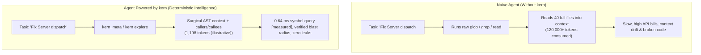
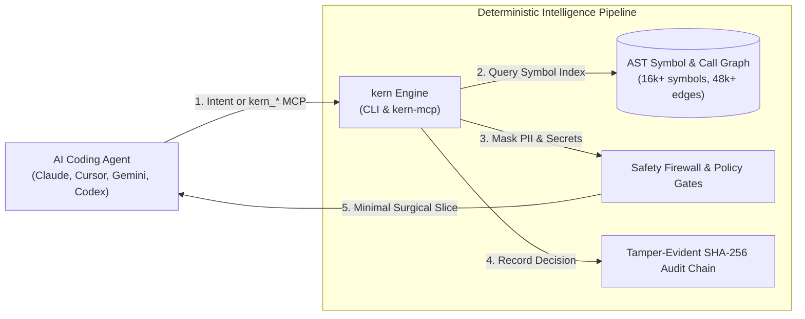

<div align="center">

# kern

### The local, deterministic code-intelligence engine for AI agents

**Index · Graph · Guard · Audit · Optimize — One self-contained CLI binary. Local-first, no telemetry.**

**Why teams pick kern:** surgical AST context instead of whole-file reads · deterministic blast radius before edits · governed execution and audit trails · project memory across sessions · zero telemetry.

[](LICENSE)
[](https://go.dev/)
[](#traditional-agent-vs-agent--kern)
[](#traditional-agent-vs-agent--kern)
[-brightgreen.svg)](#how-it-works)
[](#1-install)

[](#supported-ecosystem)
[](#supported-ecosystem)
[](#supported-ecosystem)
[](#supported-ecosystem)
[](#supported-ecosystem)
[](#supported-ecosystem)
[](#supported-ecosystem)

<br>

[**Quickstart**](#quickstart) •
[**Why kern?**](#the-problem-the-ai-agent-context-crisis) •
[**Benchmarks**](#benchmark-results) •
[**SDKs**](#sdks) •
[**MCP Setup**](#connect-to-your-agent) •
[**How It Works**](#how-it-works) •
[**Documentation**](#docs)

<br>

**18 Indexed Languages · 74 Frameworks Recognized · Phase-aware MCP Routing (32 tools advertised by default, 32 in full mode) · 100% Local**<br>
**License:** MIT (see [LICENSE](LICENSE)) — all Go dependencies are permissively licensed (no copyleft exceptions; the former `golang-lru/v2` MPL-2.0 exception was removed with that dependency)

</div>

---

## The Problem: The AI Agent Context Crisis

When AI coding agents navigate codebases with traditional tools (`grep`, `find`, `cat`, or naive file reads), they hit four critical bottlenecks:
1. **Context Bloat:** Reading 20–50 full files to understand one function burns **50,000–150,000+ tokens** before any edit begins.
2. **Hallucinated Dependencies:** Blind regex searches miss indirect call edges, inheritance hierarchies, and cross-package references.
3. **Slow Iteration:** Walking disk trees over and over wastes seconds per turn.
4. **Privacy Leaks:** Raw source files and noisy logs leak secrets and API keys directly into LLM prompts.



---

## Traditional Agent vs. Agent + kern

| Dimension | Traditional Agent (`grep` / `read` / `glob`) | Agent Powered by `kern` |
|---|---|---|
| **Token Consumption** | 50,000 – 150,000+ tokens per deep task | **~20% fewer tokens across real mixed sessions [self-reported]** (500–2,500 on deep tasks [illustrative]; per-query savings on the synthetic fixture: [measured] TS-001) |
| **Search Latency** | 2 – 15 seconds walking disk trees | **0.64 ms symbol search · 6.1 ms transitive blast radius [measured]** (16.5k symbols, warm in-process index — see [Benchmarks](#benchmark-results); a fresh CLI process adds the 178 ms warm load) |
| **Code Understanding** | Flat string/regex pattern matching | **Precise AST call graphs, callers, callees & inheritance** |
| **Blast Radius & Risk** | Agent guesses dependencies | **Deterministic change impact & test coverage gaps** |
| **Security & Privacy** | Prompts send raw secrets to LLM | **100% local, automatic PII/secret masking, snapshot rollback execution** |
| **Governance & Audit** | Zero auditability | **Tamper-evident SHA-256 hash chain & cryptographic proofs** |

> **Measured first.** Headline numbers in this README lead with what `kern bench`
> measured on this repo; best-case figures stay labeled `[illustrative]`:
> `[measured]` = reproducible protocol in docs/benchmarks/, `[synthetic]` = fixed
> deterministic fixture, `[self-reported]` = kern's own ledger (no external
> baseline), `[illustrative]` = anecdotal or best-case. The hero table's
> latency figures are the warm-index medians from the [Benchmarks](#benchmark-results)
> table below (0.64 ms search, 6.07 ms blast radius at 16,531 symbols, warm load 178 ms).
> Across real mixed sessions, `kern stats` reports roughly **20% fewer tokens overall**
> (see the `kern doctor` example below); your own number is whatever `kern stats` prints.
> The reproducible benchmark tables further down use synthetic fixtures and say so.

---

## Quickstart

> ### The 60-second path
>
> 1. Run the installer below.
> 2. Open a project and run `kern index .`.
> 3. Ask your agent: **“What breaks if I change `Server.dispatch`?”**
>
> The installer wires your agents machine-wide; use `kern setup --dry-run` first if you prefer to preview every write.

### 1. Install

One command, prebuilt static binary (no runtime required):

```bash
# macOS / Linux
curl -fsSL https://raw.githubusercontent.com/JayveerPrajapati/kern/main/install.sh | sh

# Windows (PowerShell)
powershell -ExecutionPolicy Bypass -c "irm https://raw.githubusercontent.com/JayveerPrajapati/kern/main/install.ps1 | iex"
```

Prefer to look before you install? After a download-only install
(`KERN_AUTO_WIRE=0`), `kern doctor` reports install and index health and
`kern setup --dry-run` previews exactly what wiring would be written —
both read-only, nothing changed.

The installer prints every step as it completes (platform detection → release
resolution → download → checksum verification → install → macOS Gatekeeper
re-sign → `kern version` check → a real `kern-mcp` MCP initialize handshake)
and aborts loudly on any failure — never a silent partial install. On macOS
the handshake probe turns the "Gatekeeper kills kern-mcp" failure mode into
a deterministic per-install verdict with the exact fix commands on failure.

Beyond the default install, the script manages the full lifecycle:

```sh
curl -fsSL .../install.sh | sh -s -- status     # installed version, path, platform
curl -fsSL .../install.sh | sh -s -- upgrade    # compare + swap if newer (with backup)
curl -fsSL .../install.sh | sh -s -- uninstall  # prefix-scoped (--machine adds machine state; --yes skips prompt)
```

`uninstall` removes the binaries and the PATH rc lines naming this install
prefix. Machine state — the kern block in `~/AGENTS.md` (surgically excised,
backup kept), `~/.config/kern` / `~/.cache/kern`, and the machine-secret
directory (`os.UserConfigDir`/kern: audit-chain key, approval signing keys) —
is removed only with `uninstall --machine`, so a smoke install rooted at a
scratch `KERN_INSTALL_DIR` can be uninstalled without touching the real
install's state. Pin a
version with `KERN_VERSION=v1.2.3`, relocate with `KERN_INSTALL_DIR=dir`;
when a platform has no prebuilt asset the installer falls back to
`go install` automatically. Windows users get the native PowerShell installer
(`install.ps1` — the same install/upgrade/status/uninstall lifecycle, with
checksum-verified downloads and the same prefix-scoped uninstall:
`-Machine` opts into removing
`~/.config/kern` / `~/.cache/kern` and the kern block from
`~/AGENTS.md`); Git-Bash users can run `install.sh` (zip path documented).
`kern update` is uniform across platforms — it runs `install.sh` on
macOS/Linux and `install.ps1` via PowerShell on Windows automatically,
including replacing a running `kern.exe` (renamed aside).

> **Install once, every repo works.** The installer wires kern **machine-wide**
> (`kern setup --global-only --global-rules`): user-level MCP registration, hooks
> and rules for every supported agent, plus a global git ignore for `.kern/`.
> **It writes no file in any repo.** The first time an agent works in a repo,
> kern indexes it on demand (the global rules tell the agent to call
> `kern_buddy` first). Your home `~/AGENTS.md` is backed up to
> `~/AGENTS.md.bak.<timestamp>` before its kern block is rewritten.
>
> - **Look first, change nothing:** `kern doctor` verifies install health and
>   `kern setup --dry-run` previews the files wiring would write — both
>   read-only.
> - **Git hooks, machine-wide:** pre-commit runs
>   `kern verify --staged security,architecture`;
>   pre-push refuses force-push and deletion of `main`/`master` (change with
>   `KERN_PROTECTED_BRANCHES="main release"`); each repo's own hooks still run.
>   Both fail open if kern is missing. Emergency override, audited to
>   `~/.kern/audit/bypass.jsonl`: `KERN_BYPASS=1 KERN_BYPASS_REASON="..." git push`.
> - **Opt out of machine-wide wiring:** install with `KERN_AUTO_WIRE=0`
>   (`$env:KERN_AUTO_WIRE="0"` on Windows), then wire later with
>   `kern setup --global-only` when you choose. Preview with `--dry-run`.
> - **Undo:** `kern setup --remove` removes only kern's own entries and blocks
>   from your user-level config (preview with `--dry-run`, limit with
>   `--agents`; edited files are backed up first; `~/.kern` data is kept).
> - **Safety rails:** kern will not auto-index your home directory, a
>   filesystem root or a documents folder (override: `KERN_ALLOW_BROAD_INDEX=1`;
>   `kern index <dir>` is always allowed). The global hook **fails open**: if
>   kern is missing, or the repo has a `.kern/off` file, or `KERN_DISABLED=1`
>   is set, built-in read/grep/bash are not redirected.
> - **Share setup with a team:** run `kern setup` inside a repo to add the
>   shared config files (`.mcp.json`, `AGENTS.md`, plugin, skills) for the
>   agents it detects (`--all-agents` for every supported agent, `--plain` for
>   non-interactive output; interactive runs show a plan and ask first).
>   Skip `setup` entirely if you prefer to register the MCP server by hand —
>   e.g. `claude mcp add kern -- kern mcp` (see
>   [Connect to Your Agent](#connect-to-your-agent)).

**Release channels** — `KERN_CHANNEL` selects which release `latest`
resolves to (an explicit `KERN_VERSION=v1.2.3` pin always overrides it):

- `latest` (default) — the newest release, 4-component hotfixes included
  (today's `/releases/latest` behavior).
- `stable` — the newest 3-component release; 4-component hotfixes like
  `v0.9.9.1` are never picked automatically.
- any other value — a regex over release tag names, e.g.
  `KERN_CHANNEL='^v0\.9\.'` to stay on the 0.9 line (newest match wins).

The same selection is available from the CLI: `kern update --channel stable`
(forwarded to the installer as `KERN_CHANNEL`; `--pin <tag>` still wins).
A channel that resolves to an OLDER tag than the installed version is
refused by the same downgrade gate as today — only an explicit
`--pin <tag>` consents.

**Org governance** — `KERN_ORG_ROOT` turns on org mode (org-wide policy
distribution):

- `KERN_ORG_ROOT=/path/to/org-root` — the org root. Enables the org policy
  document (`<root>/.kern/org-policy.json`): org-wins policies that every
  project firewall under the org root derives its rules from. Managed with
  `kern policy set|get|apply` (see `docs/cli-reference.md`).

See `docs/configuration.md` → "Org governance environment variables" for the
full blast radius.

Prebuilt installs now **prefer the tree-sitter-enabled build**: the release
ships a `-full` asset per native platform (Linux amd64/arm64, macOS
amd64/arm64, Windows amd64), compiled with CGO on a matching runner, and
`install.sh` / `install.ps1` probe for it first. When no `-full` asset
exists (Windows arm64 has no native build yet, or the release is missing
one), the installer automatically falls back to the **pure-Go** build
(SQLite + regex-heuristic extraction — compiled with `-tags sqlite,notreesitter`),
which is what the cross-compiled tarballs have always shipped. Set
`KERN_FORCE_PUREGO=1` to skip the `-full` probe entirely. The default
**from-source** build (`make build`) also includes the tree-sitter indexer
and requires CGO (a C compiler). Opt out to the pure-Go build with
`make build-purego` / `make install-purego`, or set `KERN_PUREGO=1` when
the installer falls back to `go install`.

<details>
<summary><b>Other install options (Homebrew, Go install, Source)</b></summary>

```bash
# Homebrew
brew install --build-from-source ./homebrew/kern.rb

# Go Install (Go 1.27+; the default build includes tree-sitter and needs a
# C toolchain — add -tags notreesitter for the pure-Go build, or set
# KERN_PUREGO=1 when installing via install.sh/install.ps1)
go install github.com/JayveerPrajapati/kern/cmd/kern@latest
go install github.com/JayveerPrajapati/kern/cmd/kern-mcp@latest

# Build from source (default = tree-sitter + CGO; make build-purego for pure-Go)
make build  # Produces bin/kern, bin/kern-mcp
```
</details>

### 2. Connect to Your Agent

Auto-configure Antigravity, Claude Code, Cursor, OpenCode, Gemini CLI, Codex, VS Code, Windsurf, Copilot, and all MCP clients:

```bash
kern setup           # Project-level MCP config & usage rules
kern setup --global  # Machine-wide: wires all agents + global git commit protection
```

### 3. Initialize & Index

```bash
cd your-project
kern index .        # Fast one-shot AST indexing
```

### 4. Ask Your Agent Anything

Ask your connected AI agent naturally:
> *"What breaks if I change `Server.dispatch`? Who depends on it, and why?"*

`kern` answers from the prebuilt index instantly — no file-by-file scanning.

### 5. Common Tasks

Everyday questions, answered by the CLI directly (agents reach the same
functions through the MCP tools):

| Task | Command |
|---|---|
| **How do I optimize a prompt?** | `kern optimize "…"` — strips filler, masks secrets, preserves context |
| **How do I compress a log?** | `kern optimize --kind log "…"` (or `kern compact`) — keeps errors + stack frames |
| **How do I search this codebase?** | `kern search <symbol>` — typed results, not raw grep lines |
| **What depends on this symbol?** | `kern impact <symbol>` — transitive blast radius + risk |
| **How do I review changes?** | `kern review` — token-optimized diff review against the index |
| **How do I check everything works?** | `kern doctor` — binary, agent configs, and index health |
| **How do I verify a change without the full suite?** | `kern verify --command "go test ./internal/foo/..." --output summary` — runs only what you name (a full `kern verify build,test` on a repo this size takes ~10 min [illustrative]; scope it to the packages you touched) |

Agents get the same answers via `kern_search`, `kern_optimize` (action=prompt|log),
`kern_impact`, `kern_review`, and `kern doctor`.

### 6. Autonomous Interception & Emergency Break-Glass

`kern` acts as a zero-intervention governance layer across all connected AI agents and Git repositories on your machine:

* **Autonomous Pre-Tool Interceptor:** Naive tool calls (`view_file`, `read_file`, `grep`, `run_command`, `bash`) in **Antigravity (`agy`)**, **OpenCode**, **Cursor**, **Claude Code**, etc., are automatically intercepted and redirected to token-dense `kern_*` tools (`kern_compact_file`, `kern_search`).
* **Machine-Wide Git Firewall:** Every `git commit` in any repository on disk runs fast staged validation (`kern verify --staged security,architecture`) to prevent secret leaks and architectural boundary violations. `post-commit` automatically records diffs into project memory (`.kern/memory/`).
* **Emergency Break-Glass Override:** For P0 production incidents, bypass all gates instantly:
  ```bash
  # Single-command hotfix:
  KERN_BYPASS=1 KERN_BYPASS_REASON="P0 hotfix" git commit -m "fix: emergency db failover"

  # Or export for the active terminal session:
  export KERN_BYPASS=1
  # (or export KERN_ENFORCE=0)
  ```
  Emergency bypasses allow the action immediately, downgrade hard blocks to advisory warnings, and log an auditable SHA-256 record to `.kern/audit/ledger.jsonl`.

---

## Benchmark Results

Reproducible on any machine — `go run ./evaluate/bench` (or `make bench`), fixed **synthetic** corpora, no network — not real-workload measurements:

| Operation | Before | After | Token Reduction | Note |
|---|---|---|---|---|
| **Optimize Prompt** | 213 tokens | 142 tokens | **33.3%** | Deterministic, keeps code/paths |
| **Optimize Log** | 176 tokens | 69 tokens | **60.8%** | Preserves errors + stack frames |
| **Output Compression (Terse)** | 208 tokens | 193 tokens | **7.2%** | Strips conversational filler |
| **Budget Fit (40 tok)** | 176 tokens | 32 tokens | **81.8%** | Delivers essential head + key lines |


**Query latency & cold start** [measured] — measured on this repo with `kern bench`
(16,531 symbols · darwin/arm64, go1.27.1, 8 cpus · git `98065fd4`; warm
in-memory index unless noted; median of repeated runs):

| Operation | Median | Note |
|---|---|---|
| **Cold index build** | 904 ms | fresh `index.Build` from source (1 run) |
| **Warm index load** | 178 ms | persisted-store load — 5.1× faster than cold |
| **Symbol search** | 0.64 ms | `main`, warm in-memory index |
| **Ranked search** | 12.36 ms | `main`, warm in-memory index |
| **One-hop callers** | <0.01 ms | top-hub symbol (`strings.Contains`, 42 ns) |
| **Transitive blast radius** | 6.07 ms | top-hub symbol, walks full caller graph |
| **Hub ranking** | 91.55 ms | full-repo scan |

These are **in-process** query times on a warm index. A fresh CLI process also
pays command dispatch plus the warm index load: the 2026-10-28 audit measured
**329 ms** for `kern search`, **377 ms context**, **799 ms explore**, **1,077 ms
impact** per cold process. The resident daemon removes the reload for its
proxied commands; it retains one hydrated index per project for 15 idle minutes,
and a fully hydrated index costs roughly **339 MB at 17.7k symbols** — plan
memory for large monorepos.

**One-shot cold start vs `grep -rn`** [measured] — the question everyone asks,
measured honestly on real repos with a same-tree protocol (both tools scan
identical copies stripped to kern's own ignore list — see
[`docs/benchmarks/cold-start.md`](docs/benchmarks/cold-start.md);
median of runs, M1 Pro):

| Repo scale | kern cold-build (index + query) | kern cold-load (persisted index) | `grep -rn` |
|---|---|---|---|
| 83 files | 92 ms | 86 ms | **70 ms** |
| 189 files | 456 ms | **134 ms** | 496 ms |
| 2,029 files (this repo) | 1.6 s | **463 ms** | 1.5 s |
| 7,819 files / 2.2M LOC | 11.8 s | **872 ms** | 5.8 s |

Grep wins only below ~200 files. Above that, a loaded kern index answers
**3–7× faster than a full grep scan** — and the first build (1.4–2× one
grep pass, paid once) is amortized to query-only cost by the resident MCP
server.

**At 12,001 symbols / 240 files** [synthetic] (deterministic scaled fixture, median of
5 runs): "what depends on X" blast-radius query **~3.1 ms**, full hub
ranking **~21 ms** — see [`docs/benchmarks/graph-latency.md`](docs/benchmarks/graph-latency.md).

Reproduce: `make bench-latency` (or `go run ./cmd/kern bench`) — deterministic,
zero network; writes `.kern/bench.json` (rendered by the web console's
/benchmarks page). Cold-start ladder: `docs/benchmarks/cold-start.md`.

---

## How It Works



1. **Extraction & Indexing** — `go/ast` parses Go precisely; the default build compiles deep tree-sitter grammars for 13 languages (requires CGO); `-tags notreesitter` opts out to a zero-dependency regex-heuristic extractor that covers 16 languages. (18 languages are indexed in total; Dart is tree-sitter-only.)
2. **Deterministic Storage** — Content-hash-verified index cached under `~/.cache/kern/`, with SQLite WAL + FTS5 full-text search compiled in by default.
3. **Deep Graph Intelligence** — 60+ CLI commands and 32 MCP tools compute call graphs, blast radius, change impact, dead code, hotspots, and architecture boundaries.
4. **Autonomous Auto-Sync** — File-event watchers (inotifywait/fswatch + polling fallback) update the index on save, backed by staleness checks on every read.

---

## Connect to Your Agent

`kern setup` connects to 11 MCP clients automatically (12 config surfaces incl. Copilot's global MCP config). To configure manually:

<details open>
<summary><b>Claude Code</b></summary>

```bash
claude mcp add kern -- kern mcp
```
</details>

<details open>
<summary><b>Cursor / VS Code (.mcp.json)</b></summary>

Add to your project's `.mcp.json`:
```json
{
  "mcpServers": {
    "kern": { "command": "kern", "args": ["mcp"] }
  }
}
```
</details>

<details>
<summary><b>Codex, Gemini CLI, Windsurf, Zed, Continue</b></summary>

Run `kern setup` or check [`docs/mcp-client.md`](docs/mcp-client.md) for custom JSON adapter instructions.
</details>

---

## MCP Tools & Routing

By default, `kern` advertises the **full 32-tool catalog** routed through the smart **`kern_meta`** natural-language dispatcher: the original seven (`kern_meta`, `kern_search`, `kern_explore`, `kern_impact`, `kern_apply`, `kern_verify`, `kern_buddy`, and `kern_exec` — governed: execution fails closed without `KERN_ALLOW_EXEC` or a `KERN_TOOLS` entry) plus 24 usage-curated additions (`kern_compact_file`, `kern_run`, `kern_optimize`, `kern_context`, `kern_memory`, `kern_evidence`, `kern_probe`, `kern_plan`, `kern_doc`, `kern_project_map`, `kern_ast_search`, `kern_stats`, `kern_why`, `kern_heal`, `kern_fit_context`, `kern_plan_context`, `kern_path`, `kern_semcache`, `kern_swap`, `kern_mask_pii`, `kern_fetch_raw_anchor`, `kern_review`, `kern_graph`, `kern_arch`). The full 32-tool catalog is advertised by default, 32 in full mode — every tool is available to agents directly (standing mandate 2026-10-23: agents use all available tools); `kern_meta`'s internal router still reaches every catalog tool with structured argument passthrough.

| Core Tool | Purpose | What it Replaces |
|---|---|---|
| **`kern_meta`** *(default)* | Single natural-language entry point — routes to the right tool automatically | Guessing tools |
| **`kern_search`** *(default)* | Sub-millisecond AST symbol search by name [measured]; ranked/prose ~17 ms | `grep` / `find` |
| **`kern_context`** *(default)* | Minimal relevant source slice for a symbol (definition + callers + callees) | `cat` / `read` |
| **`kern_explore`** *(default)* | Full symbol call hierarchy, callers, callees, and blast radius | Manual file crawls |
| **`kern_impact`** *(default)* | Predicts blast radius, risk rating, and test gaps before changing code | Guesswork refactoring |
| **`kern_apply`** *(default)* | Applies edits transactionally, verifies, and rolls back on failure — with a receipt hash | Unsafe multi-file agent edits |
| **`kern_plan`** *(default)* | Deterministic multi-file implementation plan for a proposed change | Ad-hoc edits |
| **`kern_run`** *(default)* | Orchestrates complete multi-step tasks across the explore-plan-edit-verify loop | Manual tool chains |
| **`kern_verify`** *(default)* | Unified verification engine across build, test, security, and architecture | Fragmented check scripts |
| **`kern_review`** *(default)* | Token-optimized code review context for diffs and pull requests | Whole-file diff reviews |
| **`kern_optimize`** *(default)* | Strips boilerplate and masks secrets before sending prompts | Unsafe prompt leaks |
| **`kern_buddy`** *(default)* | Session onboarding digest: conventions, layout, entry points, gotchas | Fresh-repo spelunking |
| **`kern_exec`** *(default)* | Governed script runner — snapshot rollback with governance, PII-masked output; fails closed without `KERN_ALLOW_EXEC` or a `KERN_TOOLS` entry | Ungated shell access |
| **`kern_compact_file`** *(default)* | Compact symbolic file summary instead of reading the whole file (tier=full verbatim) | Whole-file reads |
| **`kern_memory`** *(default)* | Project brain memory: add / list / recall / remove lessons | Lost cross-session lessons |
| **`kern_evidence`** *(default)* | Signed-evidence toolkit: verify / explain / export / anchor | Unverifiable claims |
| **`kern_probe`** *(default)* | Task → budget-capped symbol bundle (definitions, callers, callees, tests) | Ad-hoc task context gathering |
| **`kern_doc`** *(default)* | Project docs: search / fetch / index (the only network call in kern) | Web searches |
| **`kern_project_map`** *(default)* | Compressed whole-project map: files, symbols, line counts | Glob + full reads |
| **`kern_ast_search`** *(default)* | AST-level symbol search ('func greet', 'type *User*') | Regex grep |
| **`kern_stats`** *(default)* | Before/after token savings and cost estimates | Guessing token spend |
| **`kern_why`** *(default)* | Symbol rationale: doc comment, dependents, why, edge counts | Blind archaeology |
| **`kern_heal`** *(default)* | Self-correction loop on failing files (throwaway snapshot) | Manual fix loops |
| **`kern_fit_context`** *(default)* | Fit files/symbols into a token budget (tiered AST folding) | Token-budget guessing |
| **`kern_plan_context`** *(default)* | Deterministically plan which context a change needs | Over-/under-fetching context |
| **`kern_path`** *(default)* | Shortest call path between two symbols | Manual call-graph walks |
| **`kern_semcache`** *(default)* | Inspect/manage the semantic cache (stats / list / clear / similarity) | Repeated identical queries |
| **`kern_swap`** *(default)* | Swap fenced code blocks ↔ per-file symbolic signatures | Raw code dumps |
| **`kern_mask_pii`** *(default)* | Local secret/PII scan (API keys, tokens, URLs, emails) | Prompt leaks |
| **`kern_fetch_raw_anchor`** *(default)* | Re-read truncated anchor output (full logs/code slices on demand) | Lost truncated output |
| **`kern_graph`** *(default)* | One-call graph context: callers, callees, blast radius | Manual call-graph walks |
| **`kern_arch`** *(default)* | Architecture overview from call-graph communities + coupling warnings | Guesswork architecture |

*The 32 ***(default)*** tools are the full catalog — what a wired agent sees on
`tools/list`. The full 32-tool catalog is the default surface (standing mandate
2026-10-23: agents use all available tools).
On a default install an agent still reaches every tool directly, and
`kern_meta`'s natural-language router dispatches internally to each
catalog tool with structured argument passthrough. `KERN_MCP_PHASE=explore|plan|edit|verify`
filters either surface to the active agent phase, and `KERN_MCP_SINGLE_TOOL=1`
collapses the advertised surface to `kern_meta` alone.*

For the generated tool-selection guide, routing matrix, risk levels, and
when-to-use guidance, see [`docs/tool-selection.md`](docs/tool-selection.md).

---

## SDKs

Local-engine SDKs (the supported integration path):

- **Python** — [sdk/python/kern_sdk](sdk/python/kern_sdk) (stdlib-only; `KernEngine` + framework adapters)
- **TypeScript** — [`sdk/typescript/src`](sdk/typescript/src) (zero-dep; `KernEngine`)

> **Deprecated:** the REST `Client`/`callTool` classes targeted the retired
> `kern-server` control plane (`/v1/*`, including `POST /v1/tools/{name}`).
> They are kept as contract-pinned references (`sdk/contract/tools_call.json`)
> and will fail against a current install. For programmatic tool calls use MCP
> JSON-RPC over `kern mcp` (stdio) or `kern-mcp --http`.

---

## Multi-Agent Specialist Squad (The 7 Roles)

`kern` embeds a 7-role specialist squad architecture (`kern run` / `internal/agents`) that autonomous agents can orchestrate across the **Explore → Plan → Edit → Verify** engineering loop:

| Specialist Role | Focus Area | Autonomy Level | Key Trigger |
|---|---|---|---|
| **Planner** (`RolePlanner`) | Requirements analysis, milestone phasing & boundary scoping | L0–L3 | `kern_plan` / `kern_meta("plan <task>")` |
| **Architect** (`RoleArchitect`) | AST call graph verification, interface satisfaction & module boundaries | L0–L3 | `kern_explore` / `kern_meta("architecture...")` |
| **Coder** (`RoleCoder`) | Isolated `.kern/sandboxes/` edits with `TreeDiff` payload extraction | L2–L3 | `kern-safe-change` / `kern_meta("refactor")` |
| **Reviewer** (`RoleReviewer`) | AST diff auditing, code maintainability & anti-pattern detection | L0–L2 | `kern_review` / `kern_meta("review staged changes")` |
| **Security** (`RoleSecurity`) | Secret scans, dependency audit & policy firewall gates | L0–L2 | `kern_verify (security)` / `kern sec` |
| **Tester** (`RoleTester`) | Reproduction test fixture synthesis & test pass rate verification | L0–L2 | `kern_verify (test)` / `kern_heal` |
| **SRE** (`RoleSRE`) | AST symbol stack trace correlation, log compression & incident triage | L0–L4 | `kern-incident-triage` / `kern_optimize (log)` |

---

## CLI Highlights

```bash
# Exploration & Context
kern explore <symbol>     # Definition + callers + callees + blast radius
kern why <symbol>         # Rationale & dependent symbols
kern context <symbol>     # Minimal source slice
kern search <query>       # Instant ranked AST symbol search

# Change Impact & Review
kern impact <symbol>      # Transitive blast radius & risk level
kern review               # Review unstaged/staged git changes against the index
kern guard                # Verify architecture boundaries

# Diagnostics & Optimization
kern doctor               # Verify binary, agent configs, and index health
kern optimize <prompt>    # Strip filler, mask secrets, and preserve context (-A/-B)
kern stats                # Track cumulative local token & cost savings
```

See [`docs/cli-reference.md`](docs/cli-reference.md) for the full command guide.

---

## Beyond Search: Entity-Aware Graph Intelligence

Deterministic workflows for the harder parts of maintenance — all local, all
graph-backed:

- **`kern graph --entities` — the entity layer.** Renders the runtime
  inventory the index extracted from your project (API endpoints, DB
  tables, topics, services, deployments) merged into the code graph, so
  you can see what talks to what. Also via MCP: `kern_graph` (entities).
- **`kern arch` — architecture communities & boundaries.** Detects
  communities, hubs and cross-community coupling in the call graph; the
  same engine that powers `kern guard`'s boundary verdicts. Also via MCP:
  `kern_arch`.

## CI gate
`kern verify` runs the unified verification engine in CI: security and architecture gates over the checked-out tree, a PASS/FAIL/WARN verdict per check, and an exit code that matches it (0 = pass/warn, 1 = FAIL findings, 3 = denied — see `kern exitcode`). `--staged` scopes every check to the staged changes instead of the whole tree.
```bash
kern verify security,architecture
kern verify --staged security,architecture   # what the pre-commit hook runs
```
The [`ci` workflow](.github/workflows/ci.yml) runs this repository's governance gate: the `kern-gate` job builds kern from the checkout and runs `kern verify --types security,architecture`, which emits a typed PASS/FAIL/WARN verdict per check and fails the job when the checked-out state fails the governance pipeline (security + architecture findings). The [`test` workflow](.github/workflows/test.yml) is the reusable unit/parity/race test suite (`on: workflow_call`), not the governance gate.

---

## Supported Ecosystem

<details open>
<summary><b>Supported Languages (18)</b></summary>

Go · Python · JavaScript (JSX) · TypeScript (TSX) · Rust · C · C++ · C# · Java · Ruby · PHP · Shell · Dart · CSS/SCSS/Less · HTML · Markdown · JSON · YAML

*SFCs (Vue, Svelte, Astro) extract `<script>` blocks automatically. 13 of the 18 languages use deep tree-sitter grammars in the default build (Go is also parsed precisely by `go/ast`); prebuilt installs ship this build on the 5 native platforms (see [Install](#1-install)), while the pure-Go build (`-tags notreesitter`) swaps in regex heuristics covering 16 languages — Dart is tree-sitter-only.*

**Accuracy by language — Go first, everything else best-effort:**

| Tier | Languages | What you get |
|---|---|---|
| **Compiler-bound** | Go | `go/ast` definitions plus `go/types`-style package binding; cross-package call edges, callers/callees, and blast radius are resolved, not guessed. |
| **AST + resolver** | Java | Tree-sitter definitions with a member-invocation resolver for local variable types (`x.bar()` → `Foo.bar()`). |
| **AST extraction** | Python, JavaScript/TypeScript, Rust, C, C++, C#, Ruby, PHP, Shell, Dart, CSS, HTML, Markdown, JSON, YAML | Tree-sitter definitions and same-file structure are reliable. Cross-file call edges rely on receiver/import heuristics and can be incomplete; treat blast radius as best-effort. |
| **Regex fallback** | all except Dart (`-tags notreesitter`) | Symbol-level structure only; call edges are lower-fidelity and skipped under `--precision strict`. |

`kern doctor` reports the tier actually recorded in your index. Add `--precision strict` to verification when a false-positive call edge is worse than a missed one.
</details>

<details>
<summary><b>Recognized Frameworks (74)</b></summary>

Spring Boot, Django, FastAPI, Flask, Express, NestJS, Rails, Laravel, Gin, Echo, Fiber, Next.js, Vue, and 61 more. Run `kern fw --catalog` for the complete catalog.
</details>

<details>
<summary><b>Supported Agents & Platforms</b></summary>

- **Agents:** opencode, Claude Code, Cursor, Codex, Gemini CLI, VS Code, Windsurf, Zed, Antigravity, GitHub Copilot, Continue, Qwen, Qoder, Kiro.
- **Platforms:** Linux (amd64, arm64), macOS (Apple Silicon, Intel), Windows (amd64, arm64).
</details>

---

<details>
<summary><b>Diagnostics (`kern doctor`) Output Example</b></summary>

```text
# kern doctor — .

[ok] AGENTS.md rules        kern entry present
[ok] binary                 ~/.local/bin/kern
[ok] binary-exec            ~/.local/bin/kern-mcp runs
[ok] capabilities           sqlite: on (persistent index + FTS5) · treesitter: on
[ok] claude                 kern MCP registered
[ok] cursor                 kern entry present
[ok] freshness              index is fresh (16529 symbols, 1893 files)
[ok] precision              tree-sitter extraction: 18 languages at AST level (2 resolved call graphs; non-Go/Java call edges are best-effort)
[ok] stats                  3720 ops, 831446 tokens saved (19.9%)

verdict: all systems operational
```
</details>

<details>
<summary><b>Security & Privacy Posture</b></summary>

- **Zero Telemetry:** No tracking, no metrics uploaded, no background pings.
- **Fail-Closed Execution:** Host commands blocked unless explicitly allowlisted (`KERN_ALLOW_EXEC=1`).
- **Secret & PII Masking:** Automatically sanitizes AWS keys, tokens, and credentials.
- **Workspace Confinement:** Tool operations confined to workspace roots (`KERN_MCP_ROOTS`).
</details>

---

## Docs

- [`docs/index.md`](docs/index.md) — docs site index: TOC of the full docs tree (ADRs, architecture ledger, recipes, benchmarks, tooling, security).
- [`docs/recipes.md`](docs/recipes.md) — Task-oriented recipes: "Is this refactor safe?", "Triage a crash", and 9 more.
- [`docs/cli-reference.md`](docs/cli-reference.md) — Complete CLI command reference.
- [`docs/tool-catalog.md`](docs/tool-catalog.md) — Full generated MCP tool catalog (32 tools).
- [`docs/tool-selection.md`](docs/tool-selection.md) — Generated tool-selection guide, routing matrix, and risk levels.
- [`docs/configuration.md`](docs/configuration.md) — Configuration, `.kern/config.json` + `.kern/kern.yaml` profiles, and environment variables.
- [`docs/duplication-benchmark.md`](docs/duplication-benchmark.md) — Duplication-detector benchmark record ([historical] — suite deleted in `a05c91c7`; scoring core survives in `internal/duplication`).
- [`docs/privacy.md`](docs/privacy.md) — Security and privacy specifications.
- [`docs/skills.md`](docs/skills.md) — Bundled agent skills & runbooks.
- [`docs/benchmarks/`](docs/benchmarks/) — Benchmark suite index: semantic retention, graph latency, telemetry audit, token savings.

---

## Stargazers & Community

If `kern` saves you context tokens, speed, or money, **give it a star ⭐ on GitHub**!

[](https://github.com/JayveerPrajapati/kern)

---

## License

[MIT](LICENSE) © 2026 Jayveer Prajapati