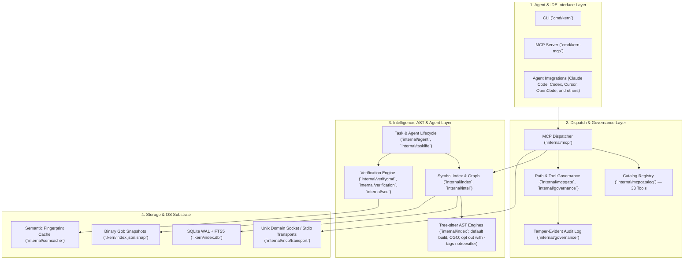
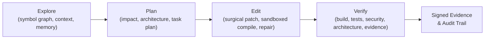

# Kern Architecture & Subsystem Specification

`kern` is a local-first, deterministic code-intelligence engine built in Go. It
pre-indexes symbols and call graphs, answers surgical context questions through
CLI and MCP, and enforces governance around edits, verification, execution, and
audit trails.

---

## 1. High-level architecture

The system is organized into four layers:



`ARCHITECTURE.md` remains the authoritative, machine-checked subsystem ledger.
The `TestArchitectureDocParity` test enforces the LOC caps and allowed internal
dependency graph declared there.

---

## 2. Agent workflow

Kern’s task pipeline follows the standard **Explore → Plan → Edit → Verify**
lifecycle:



The lifecycle is deterministic and local. Optional LLM providers are used only
for higher-level reasoning or healing when explicitly configured; the index,
call graph, blast-radius analysis, and verification engine remain deterministic.

---

## 3. Modular MCP subsystem

`internal/mcp/` pairs a capped dispatcher root with focused leaf packages.
The root is intentionally capped rather than hidden: crossing the LOC ceiling
forces the next family out to a top-level sibling such as `internal/mcpcatalog`,
`internal/mcpmeta`, `internal/mcpcli`, or `internal/mcpserve`.

```mermaid
graph TD
    Monolith["`internal/mcp` Dispatcher"]

    subgraph Context["Context & Navigation"]
        graph["`internal/mcp/graph`"]
        doc["`internal/mcp/doc`"]
        retrieve["`internal/mcp/retrieve`"]
        optimize["`internal/mcp/optimize`"]
        contextwatch["`internal/mcp/contextwatch`"]
        crossrepo["`internal/mcp/crossrepo`"]
    end

    subgraph Governance["Governance & Security"]
        gov["`internal/mcp/gov`"]
        provenance["`internal/mcp/provenance`"]
        policydsl["`internal/mcp/policydsl`"]
        fingerprint["`internal/mcp/fingerprint`"]
        preedit["`internal/mcp/preedit`"]
    end

    subgraph Mutation["Mutation & Repair"]
        refactor["`internal/mcp/refactor`"]
        repair["`internal/mcp/repair`"]
        fragility["`internal/mcp/fragility`"]
        compose["`internal/mcp/compose`"]
    end

    subgraph Runtime["Execution & Agent Control"]
        exec["`internal/mcp/exec`"]
        runtime["`internal/mcp/runtime`"]
        flight["`internal/mcp/flight`"]
        stream["`internal/mcp/stream`"]
        transport["`internal/mcp/transport`"]
        catalog["`internal/mcpcatalog`"]
    end

    Monolith --> Context
    Monolith --> Governance
    Monolith --> Mutation
    Monolith --> Runtime
```

---

## 4. Architectural invariants

1. **Parity testing** — `TestArchitectureDocParity` in
   `internal/architecture/archdoc_test.go` enforces the subsystem ledger.
2. **Fail-closed boundaries** — new internal packages must be declared in
   `ARCHITECTURE.md` with explicit LOC caps and allowed internal dependencies.
3. **No hidden growth** — subsystems that hit a cap must be extracted rather
   than silently enlarged.
4. **Local-first execution** — no implicit telemetry or network calls.
5. **Deterministic intelligence** — symbol indexing, call graphs, and impact
   analysis are deterministic; language precision is explicit.
