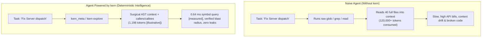

# Benchmark Overview

Why kern exists, the measured comparison against naive agent workflows, and the current benchmark results.

## The Problem: The AI Agent Context Crisis

When AI coding agents navigate codebases with traditional tools (`grep`, `find`, `cat`, or naive file reads), they hit four critical bottlenecks:
1. **Context Bloat:** Reading 20–50 full files to understand one function burns **50,000–150,000+ tokens** before any edit begins.
2. **Hallucinated Dependencies:** Blind regex searches miss indirect call edges, inheritance hierarchies, and cross-package references.
3. **Slow Iteration:** Walking disk trees over and over wastes seconds per turn.
4. **Privacy Leaks:** Raw source files and noisy logs leak secrets and API keys directly into LLM prompts.

---

## Traditional Agent vs. Agent + kern

| Dimension | Traditional Agent (`grep` / `read` / `glob`) | Agent Powered by `kern` |
|---|---|---|
| **Token Consumption** | 50,000 – 150,000+ tokens per deep task | **~20% fewer tokens across real mixed sessions [self-reported]** (500–2,500 on deep tasks [illustrative]; per-query savings on the synthetic fixture: [measured] TS-001) |
| **Search Latency** | 2 – 15 seconds walking disk trees | **0.64 ms symbol search · 6.1 ms transitive blast radius [measured]** (16.5k symbols, warm in-process index — see [Benchmarks](#benchmark-results); a fresh CLI process adds the 178 ms warm load) |
| **Code Understanding** | Flat string/regex pattern matching | **Precise AST call graphs, callers, callees & inheritance** |
| **Blast Radius & Risk** | Agent guesses dependencies | **Deterministic change impact & test coverage gaps** |
| **Security & Privacy** | Prompts send raw secrets to LLM | **100% local, automatic PII/secret masking, snapshot rollback execution** |
| **Governance & Audit** | Zero auditability | **Tamper-evident SHA-256 hash chain & cryptographic proofs** |

> **Measured first.** Headline numbers in this README lead with what `kern bench`
> measured on this repo; best-case figures stay labeled `[illustrative]`:
> `[measured]` = reproducible protocol in docs/benchmarks/, `[synthetic]` = fixed
> deterministic fixture, `[self-reported]` = kern's own ledger (no external
> baseline), `[illustrative]` = anecdotal or best-case. The hero table's
> latency figures are the warm-index medians from the [Benchmarks](#benchmark-results)
> table below (0.64 ms search, 6.07 ms blast radius at 16,531 symbols, warm load 178 ms).
> Across real mixed sessions, `kern stats` reports roughly **20% fewer tokens overall**
> (see the `kern doctor` example below); your own number is whatever `kern stats` prints.
> The reproducible benchmark tables further down use synthetic fixtures and say so.

---

## Benchmark Results

Reproducible on any machine — `go run ./evaluate/bench` (or `make bench`), fixed **synthetic** corpora, no network — not real-workload measurements:

| Operation | Before | After | Token Reduction | Note |
|---|---|---|---|---|
| **Optimize Prompt** | 213 tokens | 142 tokens | **33.3%** | Deterministic, keeps code/paths |
| **Optimize Log** | 176 tokens | 69 tokens | **60.8%** | Preserves errors + stack frames |
| **Output Compression (Terse)** | 208 tokens | 193 tokens | **7.2%** | Strips conversational filler |
| **Budget Fit (40 tok)** | 176 tokens | 32 tokens | **81.8%** | Delivers essential head + key lines |

**Query latency & cold start** [measured] — measured on this repo with `kern bench`
(16,531 symbols · darwin/arm64, go1.27.1, 8 cpus · git `98065fd4`; warm
in-memory index unless noted; median of repeated runs):

| Operation | Median | Note |
|---|---|---|
| **Cold index build** | 904 ms | fresh `index.Build` from source (1 run) |
| **Warm index load** | 178 ms | persisted-store load — 5.1× faster than cold |
| **Symbol search** | 0.64 ms | `main`, warm in-memory index |
| **Ranked search** | 12.36 ms | `main`, warm in-memory index |
| **One-hop callers** | <0.01 ms | top-hub symbol (`strings.Contains`, 42 ns) |
| **Transitive blast radius** | 6.07 ms | top-hub symbol, walks full caller graph |
| **Hub ranking** | 91.55 ms | full-repo scan |

These are **in-process** query times on a warm index. A fresh CLI process also
pays command dispatch plus the warm index load: the 2026-10-28 audit measured
**329 ms** for `kern search`, **377 ms context**, **799 ms explore**, **1,077 ms
impact** per cold process. The resident daemon removes the reload for its
proxied commands; it retains one hydrated index per project for 15 idle minutes,
and a fully hydrated index costs roughly **339 MB at 17.7k symbols** — plan
memory for large monorepos.

**One-shot cold start vs `grep -rn`** [measured] — the question everyone asks,
measured honestly on real repos with a same-tree protocol (both tools scan
identical copies stripped to kern's own ignore list — see
[`docs/benchmarks/cold-start.md`](docs/benchmarks/cold-start.md);
median of runs, M1 Pro):

| Repo scale | kern cold-build (index + query) | kern cold-load (persisted index) | `grep -rn` |
|---|---|---|---|
| 83 files | 92 ms | 86 ms | **70 ms** |
| 189 files | 456 ms | **134 ms** | 496 ms |
| 2,029 files (this repo) | 1.6 s | **463 ms** | 1.5 s |
| 7,819 files / 2.2M LOC | 11.8 s | **872 ms** | 5.8 s |

Grep wins only below ~200 files. Above that, a loaded kern index answers
**3–7× faster than a full grep scan** — and the first build (1.4–2× one
grep pass, paid once) is amortized to query-only cost by the resident MCP
server.

**At 12,001 symbols / 240 files** [synthetic] (deterministic scaled fixture, median of
5 runs): "what depends on X" blast-radius query **~3.1 ms**, full hub
ranking **~21 ms** — see [`docs/benchmarks/graph-latency.md`](docs/benchmarks/graph-latency.md).

Reproduce: `make bench-latency` (or `go run ./cmd/kern bench`) — deterministic,
zero network; writes `.kern/bench.json` (rendered by the web console's
/benchmarks page). Cold-start ladder: `docs/benchmarks/cold-start.md`.

---
